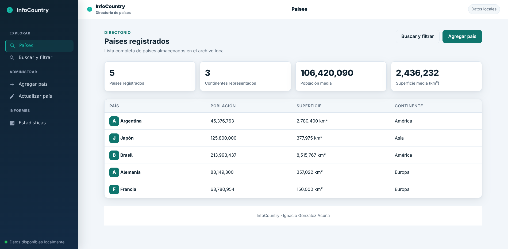

# InfoCountry



Aplicación web destinada a buscar información acerca de diferentes países del mundo.

## Stack

Python + librería Flask

##  Cómo empezar

### Linux

Seguir los siguientes pasos para trabajar localmente en linux:

```bash
# Descargar código fuente
git clone https://github.com/Nichou27/InfoCountry.git

# Entrar al projecto
cd InfoCountry

# Crear entorno virtual 
python -m venv .venv

# Activar entorno
source .venv/bin/activate

# Instalar Flask
pip install Flask

# Ejecutar en el navegador 
flask --app src/app run --debug
```

### Windows

Seguir los siguientes pasos para trabajar en Windows

```
# Descargar código fuente
git clone https://github.com/Nichou27/InfoCountry.git

# Entrar al projecto
cd InfoCountry 

# Crear entorno virtual 
py -m venv .venv

# Activar entorno
source .venv\bin\activate

# Instalar Flask
pip install Flask

# Ejecutar en el navegador 
flask --app src/app run --debug
```

En caso de necesitar más información consultar la [documentación oficial].

[documentación oficial]: https://flask.palletsprojects.com/en/stable/installation/

## Diagrama de flujo


El diagrama de flujo está hecho en formato [Mermaid.js]. Se encuentra en el 
directorio docs/DIAGRAMA_FLUJO.md, en la raíz del proyecto.

[Mermaid.js]: https://mermaid.js.org/

## Autor

Ignacio Gonzalez Acuña


