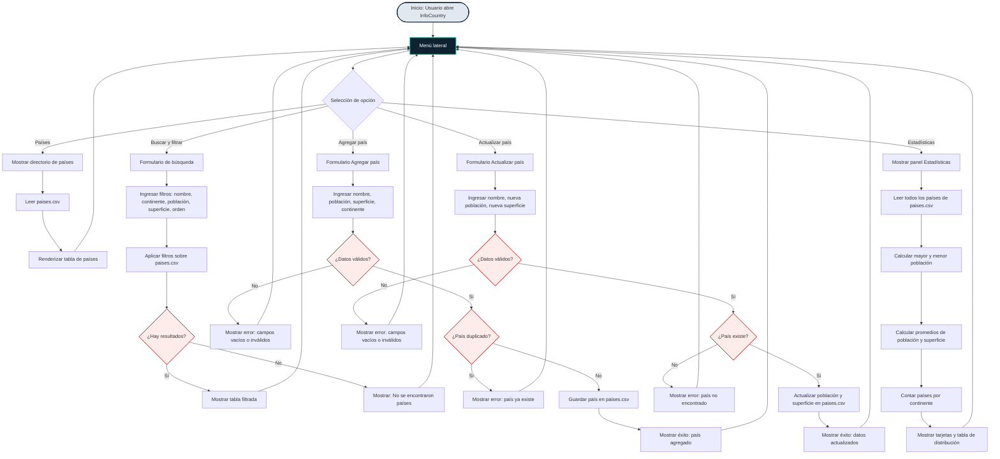

# Diagrama de flujo — Operaciones principales de InfoCountry

El siguiente diagrama está en formato [Mermaid](https://mermaid.js.org/) y puede visualizarse en GitHub, GitLab, VS Code u otros visores de Mermaid.

## Resumen de operaciones

| Módulo | Entrada | Proceso principal | Salida |
|--------|---------|-------------------|--------|
| **Países** | — | Leer `paises.csv` | Tabla de países |
| **Buscar y filtrar** | Filtros de usuario | Filtrar por nombre, continente, rangos y orden | Resultados o aviso vacío |
| **Agregar país** | Datos del país | Validar → verificar duplicado → escribir CSV | Mensaje de éxito/error |
| **Actualizar país** | Nombre y nuevos datos | Validar → buscar país → actualizar CSV | Mensaje de éxito/error |
| **Estadísticas** | — | Agregar datos de `paises.csv` | Métricas y distribución por continente |

El archivo de datos persistente es `src/lib/paises.csv`.
